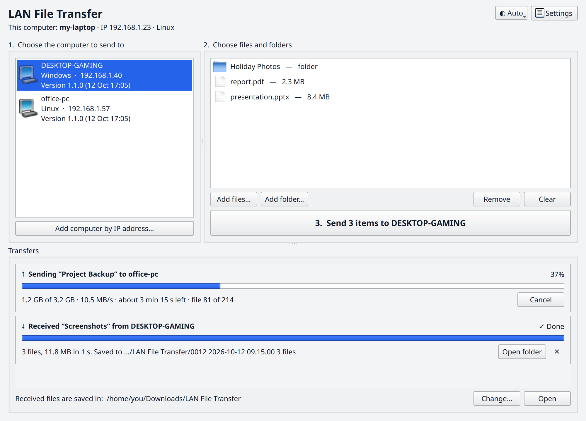

# LAN File Transfer

[](https://github.com/nokkiee/LAN-File-Transfer/releases/latest)
[](https://github.com/nokkiee/LAN-File-Transfer/releases)
[](LICENSE)
[](https://github.com/nokkiee/LAN-File-Transfer/actions/workflows/tests.yml)
[](https://github.com/nokkiee/LAN-File-Transfer/actions/workflows/build.yml)

Send files and folders between two computers on the same Wi‑Fi. Works
Windows ↔ Linux, Linux ↔ Linux and Windows ↔ Windows. Nothing goes over the
internet, and you don't need an account.

<picture>
  <source media="(prefers-color-scheme: dark)" srcset="docs/screenshot-dark.png">
  
</picture>

## Download

Get the latest version from the [Releases page](https://github.com/nokkiee/LAN-File-Transfer/releases/latest):

| Computer | File to use |
|----------|-------------|
| Windows 10 / 11 | `LAN-File-Transfer-Windows.exe` |
| Linux (64-bit)  | `LAN-File-Transfer-Linux` |

Both are single files with nothing to install. Put the right one on each
computer and run it. See [CHANGELOG.md](CHANGELOG.md) for what changed in each version.

## Using it

1. Open the app on **both** computers. After a few seconds each one shows the
   other under **“1. Choose the computer to send to”**.
2. Drag files or folders into **“2. Choose files and folders”**, or use
   *Add files…* / *Add folder…*.
3. Click **Send**. The other computer asks whether to accept. Once accepted,
   the files are saved to `Downloads/LAN File Transfer`. You can change that
   folder at the bottom of the window or in *Settings*.

Use the **◐ Auto / ☀ Light / ☾ Dark** button in the top-right corner (or *Settings*)
to choose the look. *Auto* follows your system's light/dark setting.

Each transfer you receive gets its own numbered folder, named with the order
it arrived in, the date and time, and how many files it holds, e.g.
`0007 2026-10-12 12.32.02 7 files`. Windows doesn't allow `:` in names, so the time uses
dots. **Open folder** next to a finished transfer opens exactly that folder.

Folders are sent with everything inside them. Every file is checked with a
SHA‑256 checksum, and if a name already exists the new copy gets a number
(`photo (1).jpg`), so nothing is overwritten.

If the other computer doesn't appear, use **Add computer by IP address…** and
type the IP shown at the top of the app on the other computer.

## Updating your other computers over Wi‑Fi

New versions are built on this Linux computer and sent to the others from
inside the app:

1. Build the new version with `./build_all.sh`. It builds both apps and signs
   them; the signing happens automatically.
2. Open the app on this computer. A bar at the top shows **“Version … is
   ready for …”**. Click **Update** (or right‑click a computer → *Update*).
3. The other computer asks **Update now / Not now**. After you accept, it
   downloads the new version, checks it, replaces itself and restarts. If files
   are being transferred, it waits for them to finish first.

Each computer in the list shows its version, with the build date in brackets,
for example `1.1.0 (12 Oct 16:22)`.

Updates are only installed if they were signed on the computer that built
them, so another device on the network can't push a fake “update”. They also
have to be newer than what's installed. The private signing key is created
automatically the first time you build and kept at
`~/.local/share/lan-file-transfer-release/signing-key.pem`. If it's ever lost,
a new one is made, and you copy the next version to each computer by hand once.

Copies older than 1.1.0 can't update themselves, so copy 1.1.0 to them by hand
once. The app reminds you which computers need that. To skip the question and
install updates automatically, set `"auto_install_updates": true` in that
computer's `settings.json`.

## First launch

**Windows**
- *“Windows protected your PC”* (SmartScreen): click **More info → Run anyway**.
  This appears because the app isn't code-signed.
- *Windows Firewall* asks whether to allow the app: tick **Private networks**
  (and **Public networks** if your Wi‑Fi is set to Public), then click **Allow**.
  If you missed the prompt, open *Windows Security → Firewall & network
  protection → Allow an app through firewall* and tick *LAN-File-Transfer-Windows*.

**Linux**
- Make the file executable once: right‑click → *Properties* → *Allow executing
  as program*, or run `chmod +x LAN-File-Transfer-Linux`. Then double‑click it
  or run it from a terminal.
- The first time it runs, it adds **LAN File Transfer** to your applications
  menu.
- Most desktop Linux installs have no firewall enabled. If you use one, open
  TCP port 52525 and UDP port 52526:
  - Ubuntu (ufw): `sudo ufw allow 52525/tcp && sudo ufw allow 52526/udp`
  - Fedora (firewalld): `sudo firewall-cmd --permanent --add-port=52525/tcp --add-port=52526/udp && sudo firewall-cmd --reload`

## Troubleshooting

- **Computers don't see each other:** check that both are on the same Wi‑Fi
  network (not a guest network) and that the firewall allows the app (see
  above). Some routers have “AP/client isolation” turned on, which stops
  devices from talking to each other; turn it off in the router settings or
  connect both computers to the main network. You can always fall back to
  *Add computer by IP address…*.
- **Log file:** `%APPDATA%\LAN File Transfer\app.log` on Windows,
  `~/.config/lan-file-transfer/app.log` on Linux.

## Security note

Transfers aren't encrypted, which is the usual trade-off for LAN tools like
this. Use it on networks you trust, such as your home Wi‑Fi. Nothing is ever
saved without you clicking **Accept** (unless you turn that off in Settings),
and incoming file names are sanitized so they can't write outside the receive
folder. See [SECURITY.md](SECURITY.md) for details and how to report a problem.

---

## For developers

Python 3.10+ and Qt (PySide6). The networking code (`lanxfer/discovery.py`,
`lanxfer/transfer.py`, `lanxfer/protocol.py`) has no GUI dependencies. Both
versions are built from the same source. `protocol.py` describes the wire
format.

```
main.py                     entry point
lanxfer/gui.py              the window
lanxfer/discovery.py        finding computers (UDP broadcast, port 52526)
lanxfer/transfer.py         sending/receiving (TCP, port 52525)
lanxfer/pathsafe.py         making received file names safe on each OS
lanxfer/updates.py          signed over-Wi-Fi app updates (push, verify, self-test, install)
tools/release.py            signing key, build stamp and dist/update-manifest.json
lanxfer/settings.py         settings.json
tests/test_core.py          unit/integration tests
tests/interop_peer.py       headless peer for cross-OS testing
```

Run from source: `pip install -r requirements.txt && python main.py`

Run the tests: `python -m unittest discover -s tests`

Build:
- Both apps, signed for over‑Wi‑Fi updates: `./build_all.sh` (what you normally want)
- Linux binary: `./build_linux.sh`
- Windows .exe on a Windows PC: double-click `build_windows.bat` (needs Python from python.org)
- Windows .exe from Linux: `./build_windows_on_linux.sh` (uses Wine; see the comment in
  `tools/wine_icu_stub.py` for the one workaround it needs)

The Linux binary runs on distributions at least as new as the one it was built
on. On an older distro, build it there with `./build_linux.sh`.

GitHub also builds both apps automatically (*Build apps* on the Actions tab).
Those are unsigned test builds, made on Ubuntu 22.04 so the Linux one runs on
older distributions too. Official releases are built and signed with `./build_all.sh`.

## License

[MIT](LICENSE). The downloadable apps also bundle third-party libraries under
their own licenses, mainly Qt for Python (PySide6, LGPL-3.0), `cryptography`
(Apache-2.0 / BSD) and Python itself (PSF License). Because this repo contains
the full source and build scripts, you can rebuild the apps with your own copy
of these libraries.
